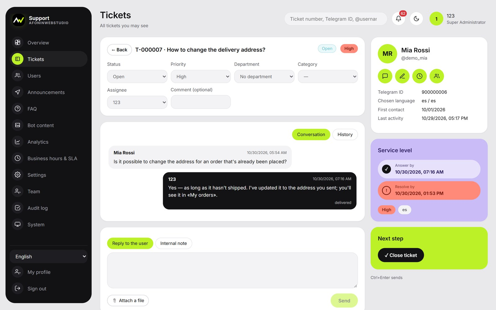
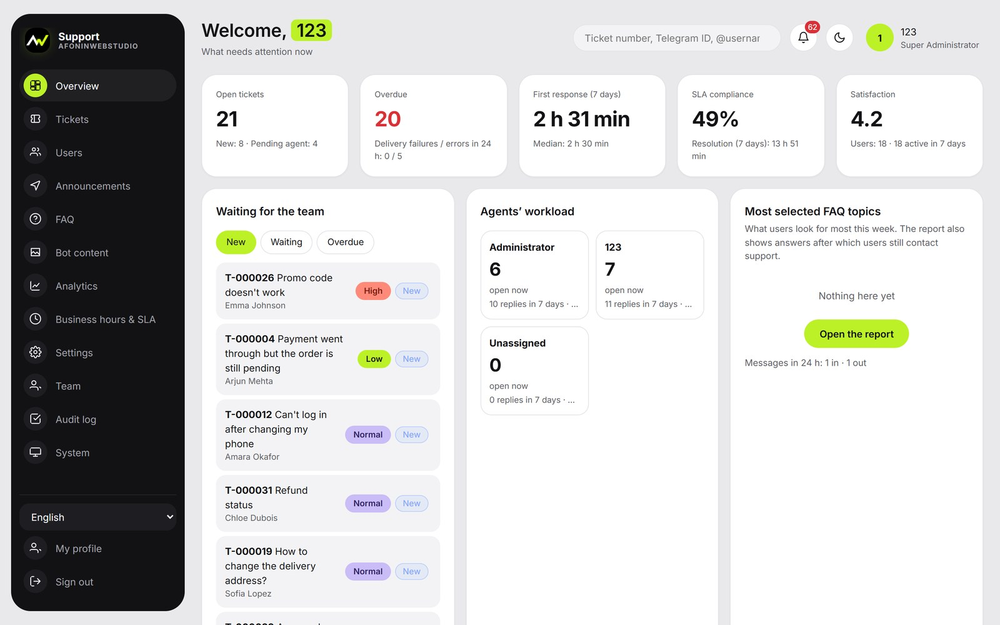
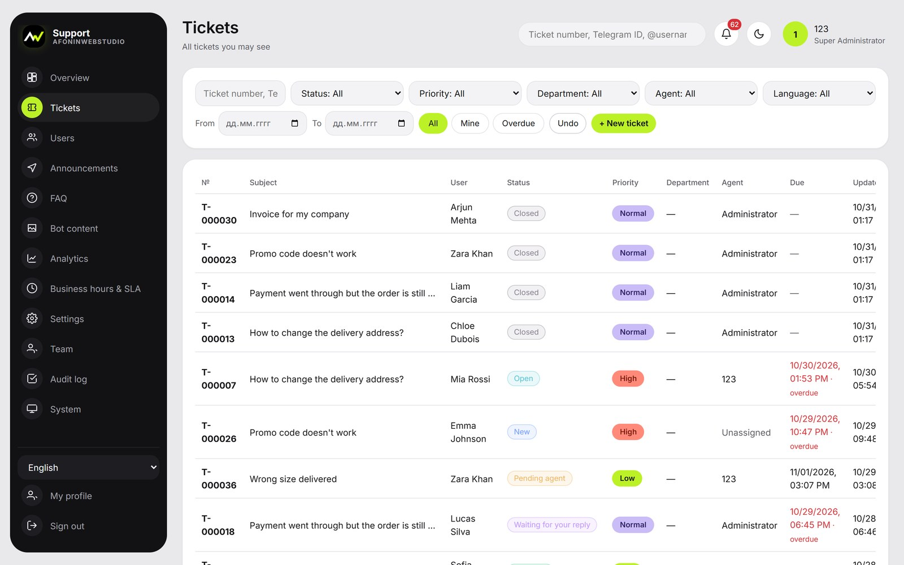
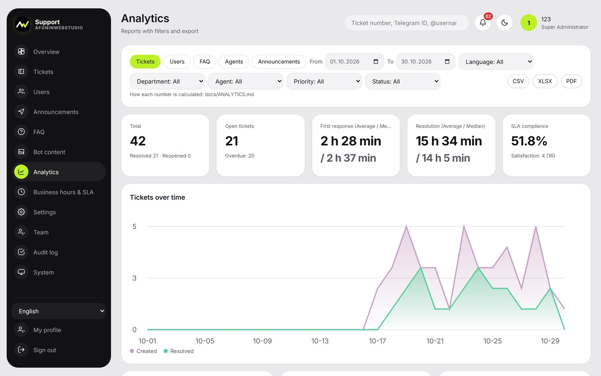
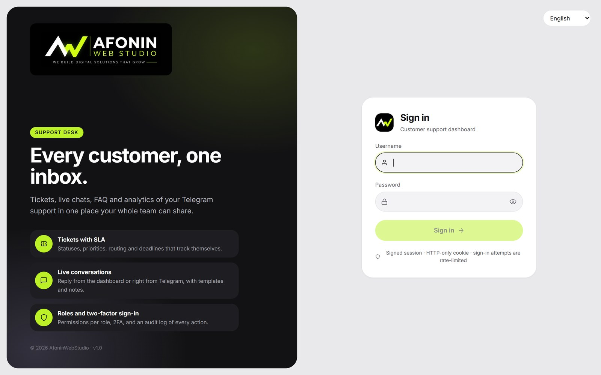
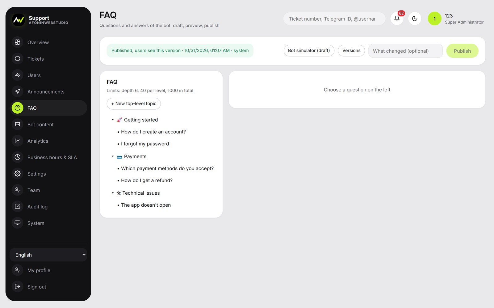
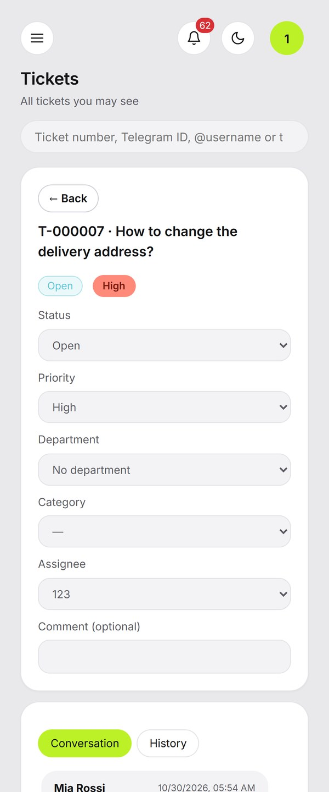
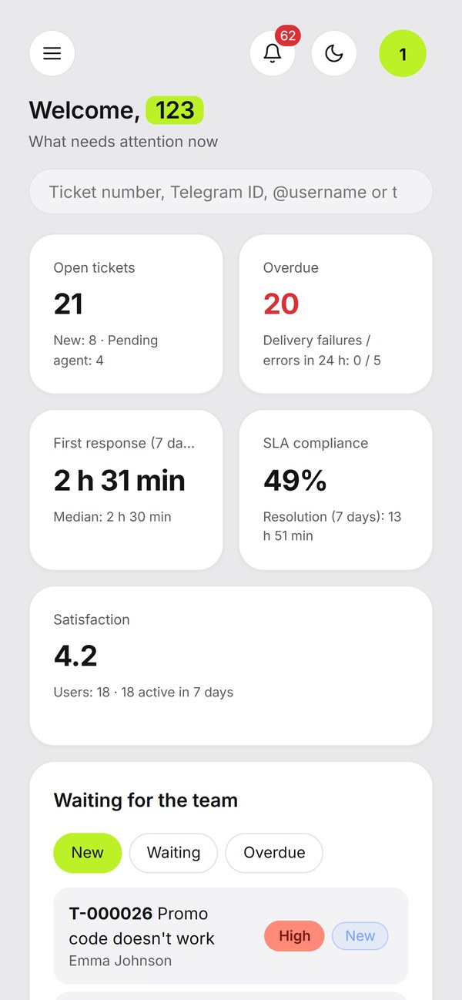
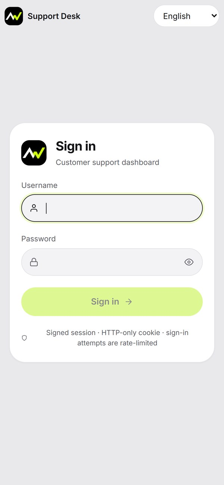
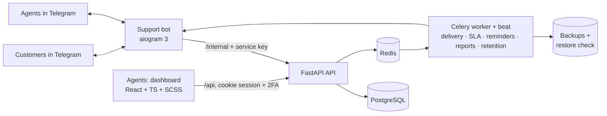

<div align="center">


# Support Desk

**A customer-support CRM for Telegram: tickets with SLA, live chat, FAQ bot and analytics — for the whole team.**

Customers write to a Telegram bot; agents answer from a clean web dashboard (or right from Telegram),
with routing, deadlines, templates, notes, roles and an audit log.

`Python 3.12` · `FastAPI` · `PostgreSQL` · `Celery` · `aiogram 3` · `React 19 + TypeScript` · `SCSS` · `Docker Compose`



</div>

---

## Contents

[What it is](#what-it-is) · [Screenshots](#screenshots) · [Features](#features) · [Architecture](#architecture) ·
[Run it locally](#run-it-locally) · [Deploy](#deploy) · [Tests](#tests) · [Project structure](#project-structure) ·
[Documentation](#documentation) · [Licence](#licence)

## What it is

| Part | What it does |
|---|---|
| **Telegram bot** | Welcome with media and buttons, interactive **FAQ tree**, «Contact support», «My tickets», language choice, «My contacts», CSAT rating after resolution |
| **Agent dashboard** | Ticket queue with filters, conversation with attachments, internal notes, templates, assignment and transfer, SLA deadlines, customer profiles, announcements, analytics, team and audit |
| **Backend + workers** | One API for the bot and the dashboard; Celery workers deliver messages with retries, watch SLA, send reminders and a weekly summary, clean up by retention rules, back up the database and test the restore |

Agents can also answer from Telegram: replies and notes go into the same ticket.

## Screenshots

| Overview | Ticket queue | Analytics |
|---|---|---|
|  |  |  |
| **Sign-in** | **FAQ builder** | |
|  |  | |

<p align="center">
  &nbsp;&nbsp;
  &nbsp;&nbsp;
  
</p>

<sub>Screenshots use the built-in demo mode: synthetic customers <code>demo_*</code>; nothing is sent to Telegram.</sub>

## Features

**Tickets**
- Unique numbers, eight configurable statuses with an allowed-transition matrix, priorities, departments, categories.
- Assignment rules (by language, category, load or round robin), transfer and escalation, reopening by the customer.
- **SLA** for first answer and resolution in business hours, paused while waiting for the customer, warnings before
  a breach, overdue flags; reminders to customers who did not answer.
- Duplicate protection: a retried Telegram update never creates a second ticket or message.

**Conversations and content**
- Reply from the dashboard or Telegram, attachments, templates per language, internal notes, delivery statuses.
- FAQ tree of any depth with media and buttons, draft → publish, a simulator to test answers before publishing.
- Announcements to segments (language, activity, tags), scheduled, rate-limited, opt-out with `/stop`.

**Team and control**
- Five built-in roles and custom ones; every route checks its permission; two-factor sign-in (TOTP).
- Audit log of permissions, bans, exports, status changes and settings.
- Analytics with documented rules: response and resolution times (median, SLA compliance), FAQ, agents, campaigns;
  export to **CSV, Excel and PDF** (formula-injection safe).
- Customer profiles with history; contacts only when the customer gives them; export, delete, anonymise.
- **11 languages** in the bot and the dashboard, including right-to-left Arabic, Hebrew and Urdu.

**Engineering**
- Bot separated from the backend: it talks only to `/internal/*` with a service key.
- Backups with an automatic restore check; health of the scheduler and workers on the System page.
- Behind any reverse proxy: trusted-proxy handling for real client addresses, CSP, rate limits.
- Design system in **SCSS** (tokens → CSS custom properties, functions, mixins); WCAG AA contrast checked by a test.

## Architecture



## Run it locally

No Docker needed: SQLite and in-process Redis.

```bash
python -m venv .venv && .venv\Scripts\activate          # Windows (Linux/macOS: source .venv/bin/activate)
pip install -e ".[test]"
python -m infrastructure.scripts.dev                       # API on http://127.0.0.1:8100
```

```bash
cd dashboard && npm ci && npm run dev                      # dashboard on http://localhost:5173
```

The first run creates an administrator and prints where its password is saved (`local/dev-admin.txt`).
Set `DEMO_DATA=1` before the first command to fill an empty local database with clearly marked demo tickets.
A test bot token goes to `local/.env` (`BOT_TOKEN=...`).

## Deploy

Any Linux server with Docker; ready configurations for Plesk, nginx, Apache and Caddy:

```bash
sudo bash infrastructure/scripts/server-setup.sh support.example.com
```

Step by step: [docs/DEPLOYMENT.md](docs/DEPLOYMENT.md) · configuration: [docs/CONFIGURATION.md](docs/CONFIGURATION.md) ·
backups: [docs/BACKUP_RESTORE.md](docs/BACKUP_RESTORE.md).

## Tests

```bash
pytest -q                                                   # unit, integration and bot scenario tests
TEST_DATABASE_URL=postgresql+psycopg://... pytest -q        # the same on PostgreSQL
cd dashboard && npx tsc --noEmit && npx vite build
```

91 tests cover the ticket lifecycle, SLA and reminders, routing, permissions, 2FA, exports, announcements,
translations, end-to-end bot scenarios and the design tokens' contrast.
GitHub Actions runs them on every push ([.github/workflows/ci.yml](.github/workflows/ci.yml)).

## Project structure

```
backend/          FastAPI app: api/, services/ (tickets, SLA, analytics, permissions, i18n), models/, migrations
bots/             the Telegram bot (aiogram 3)
workers/          Celery worker and scheduler
dashboard/        agent dashboard: React + TypeScript + Vite, styles/ (SCSS design system)
infrastructure/   Dockerfile, backup service, server setup, web-server configs, local runner, demo data, API docs generator
tests/            unit/ and integration/
docs/             documentation and the generated OpenAPI description
```

## Documentation

| Topic | Document |
|---|---|
| Install and run | [Deployment](docs/DEPLOYMENT.md) · [Configuration](docs/CONFIGURATION.md) · [Backup and restore](docs/BACKUP_RESTORE.md) |
| Access and safety | [Roles](docs/ROLES.md) · [Security](docs/SECURITY.md) · [Personal data](docs/LEGAL.md) |
| Develop and integrate | [Data model](docs/DATA_MODEL.md) · [API](docs/API.md) ([OpenAPI](docs/openapi.json)) · [Guides](docs/GUIDES.md) |
| Reports | [Analytics rules](docs/ANALYTICS.md) |

## Licence

Source-available, **all rights reserved** — see [LICENSE](LICENSE) and [THIRD_PARTY_NOTICES.md](THIRD_PARTY_NOTICES.md).
The code may be read and run locally to evaluate it; any other use needs written permission.

Built by **Vladislav Afonin · [AfoninWebStudio](https://github.com/TheLustYoung)** — custom bots, admin dashboards and
business automation. Need a support desk like this for your product? Open an issue or get in touch through the profile.
